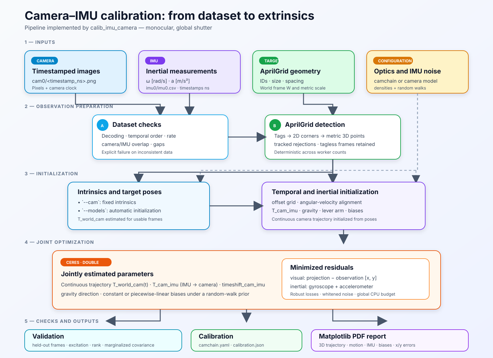

# Global-shutter camera–IMU calibration



First implementation: one camera, one IMU, a fixed AprilGrid, and optical
parameters fixed during inertial fitting. The solver estimates `T_cam_imu`,
`timeshift_cam_imu`, IMU biases, gravity direction, and a continuous trajectory.
Biases remain constant without declared random walks; with two positive random
walks, they are piecewise linear. Marginalized local covariance for `T_cam_imu`
and offset is exported with a rank diagnostic. It covers neither fixed intrinsics
nor model errors; convergence and finite covariance still yield a provisional
estimate. An HC0 sandwich estimator is also exported in an explicitly candidate
field; the validation below prohibits using it as default covariance.

## Command

```sh
build/release/calib_imu_camera --dataset ./session --cameras cam0 \
  --target examples/dtvi_aprilgrid.yaml --cam initial-camchain.yaml \
  --imu imu.yaml --output ./vi-result
```

Without intrinsics, replace `--cam initial-camchain.yaml` with
`--models pinhole-equi` (or `pinhole-radtan`) to initialize them automatically.
That initialization is then fixed: its errors and covariance are not absorbed by
joint intrinsic refinement. Any extrinsics and offsets present in `--cam` are not
used as initial values. Exactly one camera must be selected. A nonzero
`line_delay` is rejected.

The `--imu` YAML must supply two positive SI noise densities:

```yaml
gyroscope_noise_density: 0.002
accelerometer_noise_density: 0.02
```

These values serve synthetic tests and are not a universal profile. Supply
densities for the actual IMU. Kalibr keys `gyroscope_random_walk` and
`accelerometer_random_walk` are optional, but both must be strictly positive to
enable variable biases. Their absence or a zero value retains the constant model.
Effective rate comes from timestamps; per-sample noise is
`density / sqrt(median(dt))`. Noise variation is not modeled.

Specific options are `--vi-knot-interval` (default 0.05 s, range 0.02–1 s),
`--vi-max-offset` (symmetric bound, default 0.05 s, range 0.001–0.5 s),
`--vi-pixel-sigma` (default 0.8 px), and `--vi-bias-knot-interval` (default
0.1 s, range 0.02–10 s). Spline spacing must represent motion frequencies;
check stability by reducing it. Current limits are 20,000 frames, three million
corners, two million IMU measurements, and 10,000 trajectory controls. Images
remain batch-loaded; only corners and IMU measurements are retained.

Temporal bootstrap is disabled by default. It jointly requires
`--vi-bootstrap-replicates 8..128` and `--vi-bootstrap-block-seconds S`; use
`--vi-bootstrap-seed` for a reproducible seed. The explicit duration must span at
least four spline intervals and both offset margins, and the retained window must
contain at least five blocks. No duration choice is universal.

## Model and conventions

`T_A_B` transforms B into A. W is the metric frame fixed by the target; camera
trajectory `T_W_C = (R_W_C, p_W_C)` is a uniform cubic spline, cumulative on
SO(3) and ordinary on R³. Controls serialize as
`[qw, qx, qy, qz, px, py, pz]`. Zero phase of a four-control segment is centered
on the second control. Source timestamps remain int64; a common origin is
subtracted before conversion to double seconds.

The spline provides `omega_C`, `alpha_C`, and `p_W_C''`. With
`T_C_I = (R_C_I, t_C_I)` and `t_imu = t_cam + timeshift_cam_imu`, the trajectory
is evaluated at `t_cam = t_imu - timeshift_cam_imu`:

```text
p_W_I = p_W_C + R_W_C t_C_I
gyro = R_C_Iᵀ omega_C + bias_g
accel = R_C_Iᵀ [R_W_Cᵀ (p_W_C'' - g_W)
                    + alpha_C × t_C_I
                    + omega_C × (omega_C × t_C_I)] + bias_a
p_C = R_W_Cᵀ (p_W - p_W_C)
```

The lever arm includes tangential and centripetal acceleration. Gravity magnitude
is fixed at 9.80665 m/s² by a sphere manifold; its direction is estimated. The
target fixes frame and scale; the camera clock fixes the temporal origin.
Quaternions use Ceres manifolds. Covariance order is
`[delta_theta_left, delta_translation, delta_timeshift]`, with
`R_C_I' = Exp(delta_theta_left) R_C_I` and additive translation/offset. Rotation
components are radians, translation meters, and offset seconds. The Ceres
quaternion tangent is a half-angle: final conversion multiplies the three rotation
components by two before expressing covariance in radians.

## Initialization and optimization

1. Reserve one eligible frame in five for validation. Initialize camera poses from
   at least twelve corners without using reserved frames. Exclude initialization
   poses above 5 px RMS and record the reason.
2. Select the longest fitting-pose window with no gap above one second, at least
   24 poses, and at least three seconds. Interpolate initial controls, then fit the
   spline to pixels with fixed intrinsics. Temporary attachments to interpolated
   poses (0.1 rad and 0.05 m) stabilize weakly observed controls; remove them
   before camera–IMU optimization.
3. Test 39 interior offsets over 95% of the declared bound, reserving both bounds
   for the final optimizer. Initialize camera–IMU rotation by aligning centered
   angular velocities and gyro bias from their means. Initialize lever arm,
   gravity, and accelerometer bias with linear least squares, then enforce gravity norm.
4. Jointly fit controls, extrinsics, offset, biases, and gravity with Ceres, sparse
   Cholesky, and the global thread budget. Visual residuals use a 2 px Huber loss;
   whitened IMU blocks use a norm-3 Huber loss.
5. Evaluate every corner in reserved frames directly on the trajectory without
   re-estimating their poses. Large individual errors are retained.

Each IMU residual declares the union of controls required over the entire offset
range. The segment is selected from the current value and phase remains
differentiable. Segment transitions are tested; the cubic spline is C², but its
third derivative may change at a knot. A temporal margin of two spline intervals
plus the offset bound excludes edge measurements without extrapolation.

The solver rejects, among other cases, non-increasing timestamps, no overlap, IMU
gaps over 50 ms within the window, insufficient angular excitation, a degenerate
initial inertial system, non-convergence, and an offset at its bound. Version-1
policy thresholds are experimental safeguards: minimum gyro-covariance eigenvalue
0.005 (rad/s)², initial inertial-system spectral ratio above 1e-8, and median
reserved reprojection below 5 px. Median norm of each inertial residual must be
below `10 * sqrt(3) * sigma` for the sensor or the declared model is rejected.
The initial spectral check does not replace marginalized rank of the final problem.

## Outputs and validation

`camchain.yaml` contains intrinsics, `T_cam_imu`, `timeshift_cam_imu`, and
`line_delay: 0`. `calibration.json` contains SI biases, gravity, spline controls,
selected window, noise, metrics, exclusions, and large visual errors.
`report.pdf` contains twelve 6.4×4.8-inch pages following the Kalibr report:
parameter summary and limitations; 3D `T_world_imu` trajectory with pose axes;
position and unwrapped ZYX angles; IMU rate; specific-force measurements and
predictions; accelerometer residuals; accelerometer biases; gyroscope measurements
and predictions; gyroscope residuals; gyroscope biases; signed
`projection - observation` x/y residuals for every corner of every evaluated
frame; and a time-colored x/y cloud.

`T_world_imu = T_world_cam * T_cam_imu`, consistent with the IMU-to-camera
direction of `T_cam_imu`. Inertial predictions and residuals come from the actual
final evaluated model. Bias pages show either constants or the estimated
piecewise-linear trajectories. Frames rejected before optimization or outside the
continuous visual window have neither pose nor residual and are excluded. Complete
series remain transient for PDF generation; `calibration.json` retains counts and
statistics under `diagnostics.report_series`.

The twelve pages are generated directly by Python/Matplotlib using headless `Agg`
and `PdfPages`. C++ passes poses and every residual in a transient JSON, launches
the script without a shell, verifies the PDF signature, then atomically renames
the complete file. The transient JSON is removed on success; failures retain only
non-reusable `.incomplete` files. Each file is written atomically without overwrite;
a complete `summary.json` is required to accept a result set. Unknown uncertainty
is never replaced with zero. When requested, `bootstrap.json` contains the separate
diagnostic and its status; it changes neither `camchain.yaml`, primary covariance,
nor the PDF.

After convergence, Ceres evaluates the complete local Jacobian with robust losses.
A sparse Schur complement marginalizes trajectory controls, biases, and gravity
direction, then inverts the 7×7 extrinsic/offset information. Nuisance columns are
normalized before factorization. If their block is singular, two relative
regularizations (`1e-8` and `1e-10`) must produce Schur complements consistent
within `1e-3`; otherwise covariance remains `null`. Rank is evaluated on normalized
target information with a relative `1e-12` threshold. This local approximation
assumes exact intrinsics, independent noise matching the YAML, and the selected
bias model; it is neither a global error bound nor an accuracy certificate. It is
the inverse of the local Gauss–Newton Hessian with Ceres loss correction.

Nested field `covariance.sandwich` contains an experimental HC0 variant. For every
Ceres block—two pixels for a corner or six components for an IMU sample—it forms
the score from residual and Jacobian corrected by the same loss, eliminates
nuisances with the same Schur complement, then applies the outer-product “meat”.
It is produced only with a full-rank nuisance block; the regularized fallback is
excluded. Its `candidate` status and `not_qualified_for_default_use` qualification
are intentional.

The candidate bootstrap partitions common time into contiguous blocks, samples
the same number of blocks with replacement, then multiplies each Huber loss by the
exact block multiplicity. All corners in a frame and all six components in an IMU
sample remain grouped; camera times and `t_imu-timeshift_nominal` share weights.
Timestamps and spline are never concatenated. Every replication starts from the
nominal optimum, fixes only controls without a positive-weight residual, and
publishes convergence or failure reason. Empirical covariance uses `N-1` on
physical left rotation/translation/offset deltas. The central solution is then
restored exactly. This diagnostic remains conditional on one acquisition, fixed
intrinsics, and the selected bias model.

Dedicated tests are `vi_derivatives`, `vi_cost_derivatives`, the four scenarios
`vi_calibration_positive`, `vi_calibration_negative`, `vi_calibration_noisy`, and
`vi_calibration_guards`, followed by `vi_calibration_boundary`,
`vi_covariance_smoke`, `vi_intrinsics_sensitivity_smoke`, and release-only
`vi_bootstrap_smoke`. The Python generator uses trigonometric trajectories
independent of the spline, composed rotations, and fine numerical time derivatives
(10 µs for rotation, 100 µs for acceleration). It tests nontrivial extrinsics,
lever arm, gravity, biases, both offset signs, noise, outlier corners, static/
single-axis cases, cancellation, and input errors. Jacobians for all residual
parameters are compared with finite differences; temporal derivatives and spline
continuity are exercised separately. Exports are independently reread and Poppler
analyzes the PDF. The test also verifies twelve pages, titles, residual sign, IMU
samples, and equality between plotted residual count and fitting plus reserved corners.

Versioned synthetic tolerances in `tests/vi.py` are maximum rotation-element error
< 0.005, translation per axis < 10 mm, offset < 2 ms, gyro bias per axis
< 0.004 rad/s, and accelerometer bias per axis < 0.04 m/s². The same thresholds
apply to the noisy case with outlier corners and camera gaps. They are regression
criteria for these fixtures, not guaranteed accuracy on user acquisitions.

### Synthetic coverage and optical sensitivity — October 20, 2026

`scripts/qualify_vi_covariance.py` injects Gaussian noise consistent with
`pixel_sigma` and IMU densities, then compares true error with covariance under
its left-perturbation convention. The deterministic 100-trial campaign initially
found eleven initializations selecting an exact temporal bound. The grid now
reserves bounds for the final optimizer: all 100 trials converge without relaxing
rejection of a final estimate at the bound.

Marginal 95% coverage is `[0.97, 0.93, 0.97]` for rotation,
`[0.95, 0.97, 0.95]` for translation, and only `0.80` for offset. Joint coverage
at the seven-dimensional χ² threshold is `0.90`; Mahalanobis distance has median
`7.49` and P95 `17.68`. Normalized offset-error standard deviation reaches `1.50`.
Local temporal covariance therefore **undercovers on this fixture** and is not
qualified as a frequentist 95% interval.

The same campaign now compares the HC0 sandwich candidate without changing
`covariance.matrix`. Across 100/100 convergences, its marginal coverage is
`[0.95, 0.88, 0.97]` for rotation, `[0.93, 0.93, 0.95]` for translation, and
`0.80` for offset. Joint χ² coverage falls to `0.83`, Mahalanobis median/P95 rise
to `8.68/19.59`, and normalized offset standard deviation to `1.60`. This candidate
therefore **degrades qualification** and remains only an exported diagnostic.

Bounded temporal bootstrap is implemented but not yet qualified. Its noisy smoke
test with eight replications and 1 s blocks converges 8/8 in 19.83 s, produces a
defined covariance, and restores the central estimate bit-for-bit. One coverage
run checks the three-estimator schema but is not a statistical result. The next
experiment must select duration on a separate pilot (`0.5`, `1`, and `2` s), then
run the preregistered campaign before activation or frequentist interpretation.

`scripts/benchmark_vi_intrinsics_sensitivity.py` retains true pixels and perturbs
only fixed optical parameters. All 31 cases converge. A 1% focal error produces
up to about 0.028 rad rotation, 78 mm translation, and 1.22 ms offset despite
reserved median near 0.32 px. The combined case reaches 0.055 rad and 120 mm with
0.661 px reserved median. This confirms that low visual residual and covariance
conditioned on intrinsics do not cover optical-model error.

Reproduce after a release build:

```sh
python3 scripts/qualify_vi_covariance.py --trials 100 \
  --output build/vi-covariance-monte-carlo.json
python3 scripts/qualify_vi_covariance.py --trials 30 \
  --bootstrap-replicates 32 --bootstrap-block-seconds 1 \
  --timeout 120 --output build/vi-bootstrap-pilot-1s.json
python3 scripts/benchmark_vi_intrinsics_sensitivity.py \
  --output build/vi-intrinsics-sensitivity.json
```

This stage is limited to monocular GS. Variable biases remain linear interpolation
under a random-walk prior, not Kalibr's complete model. Validation images belong
to the same acquisition; with `--models`, initial intrinsics may use some of them.
The synthetic campaign does not replace an independent real comparison, which is
essential to qualify accuracy beyond convergence and reprojection tests.

### Variable biases — October 22, 2026

When both random walks are positive, the solver adds bias controls at regular
intervals, linearly interpolates each axis at IMU time, and whitens every increment
by its random walk and corresponding duration. Controls are among marginalized
nuisances; JSON exports their origin, spacing, layout, and values without reducing
the trajectory to a substitute mean bias.

On `dataset-calib-imu1_1024_16`, 0.1 s spacing produces 518 controls and converges
in 62.26 s with 373,340 KiB RSS. The 0.2 s replay converges in 49.37 s with
355,384 KiB. Between estimates, extrinsic rotation changes by 2.4148e-6 degrees,
translation by 0.000145 mm, and offset by −0.0106 µs. Stability across two spacings
and one acquisition does not yet qualify spacing, random walk, or accuracy on
another sensor.

## Real run, October 19, 2026

The following path passed on Oxford Spires (choose a new output directory to rerun):

```sh
build/release/calib_imu_camera \
  --dataset dataset/oxford-spires-2024-10-29/camera-imu \
  --target examples/dtvi_aprilgrid.yaml --models pinhole-equi \
  --imu dataset/oxford-spires-2024-10-29/published-reference/october/imu.yaml \
  --vi-knot-interval 0.025 --quad-decimate 4 --threads 2 \
  --output dataset/oxford-spires-2024-10-29/vi-gs-final
```

Over a 38.599 s window, offset is +2.07525 ms. Reserved reprojection has median
0.380 px, RMS 2.791 px, and P95 4.925 px. Difference from the published October
calibration is 2.464 mm and 0.2493°, without using its extrinsics as initialization.
This comparison is not error against ground truth. Results, spline-spacing
sensitivity, and rejected cases are detailed in
[recorded-datasets.md](recorded-datasets.md#first-gs-cameraimu-solver--october-19-2026).

One measurement of the complete path: 145.0 s and 161,992 KiB peak RSS, Intel
Core i3-1115G4 (four logical processors), two requested threads, GCC 13.3, explicit
C++23 fallback. A concurrent instrumented build affected load; this is neither
guaranteed throughput nor a controlled-load performance comparison.

The C++23 release campaign passes all **19 CTest suites** (36.24 s), including nine
VI suites, camera–camera regressions, and CLI rejection cases. The optional Python
OpenCV oracle is not enabled in this configuration. The real path exactly preserves
SHA-256 fingerprints of detections and observations from previous Oxford
initialization. After rebuilding Ceres, the `--cam` CLI path also succeeded with
the first path's `initial-camchain.yaml`. Maximum difference between `T_cam_imu`
elements is 1.39e-17, offset is identical, and observations/detections have equal
fingerprints. No fake initialization report is produced in this mode. This run
takes 126.4 s and 160,780 KiB; concurrent loads differ, so it is not a performance
gain attributable to the allocator correction. Its redundant directory was
removed after consolidating metrics into `vi-gs-final/validation.json`.

The replay after adding sandwich covariance still preserves the central estimate
within `1.39e-17` and offset exactly. Because Oxford nuisances require the
regularized limit, `covariance.sandwich.status` is `unavailable` with an explicit
reason; nominal covariance remains available. This out-of-dataset path under
`build/` takes 76.80 s, 298,700 KiB RSS, and 1.34 s for uncertainty.

ASan validation exposed an allocation incompatibility between prebuilt Ceres and
instrumented Eigen templates. `setup_ceres.py` and the Ceres CMake interface now
enforce `EIGEN_MALLOC_ALREADY_ALIGNED=0` on both sides and reject old provenance.
This correction retains ASan checks and aligned allocations; it does not suppress
the diagnostic. See [INSTALLATION.md](../INSTALLATION.md) for the required rebuild.
The GCC 13.3/C++23 instrumented configuration with ASan/UBSan and `-O2 -g0` under
`build/vi-sanitize/` covered all **16 of 16 suites** preceding the two Python smoke
tests and release boundary test, in three targeted groups totaling 669.30 s.
The four VI recovery scenarios take 207.93 s, 205.29 s, 139.61 s, and 48.38 s,
all below their individual 300 s limit. The fixture uses 181 images over nine
seconds, twelve tags spread across the field, and 921 IMU measurements. Thresholds,
both offset signs, noisy case, outlier corners, camera gaps, and guards are unchanged.
An eight-second variant was rejected: its maximum noisy rotation error reached
0.00590 for a 0.005 limit. Splitting scenarios removes the monolithic timeout
without raising one process's budget or turning numerical failure into success.

Leak detection and stop-on-diagnostic remain enabled through CTest. This grouped
campaign does not provide a new reliable global peak-RSS measurement; the earlier
monolithic campaign before final covariance measured 410,768 KiB. After correcting
temporal initialization, targeted `vi_calibration_guards` again passes under
ASan/UBSan in 53.87 s; the complete instrumented campaign was not repeated.
Ceres and OpenCV remain external release libraries whose internals are not
instrumented. C++26 was not re-exercised on this machine; the C++23 fallback is
explicit. The next stage must qualify marginalized-uncertainty coverage through
synthetic repetitions and intrinsic perturbations, qualify sensitivity to outlier
observations, then use an independent validation acquisition.
